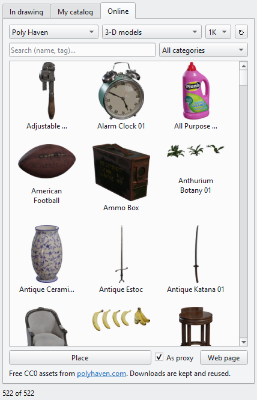
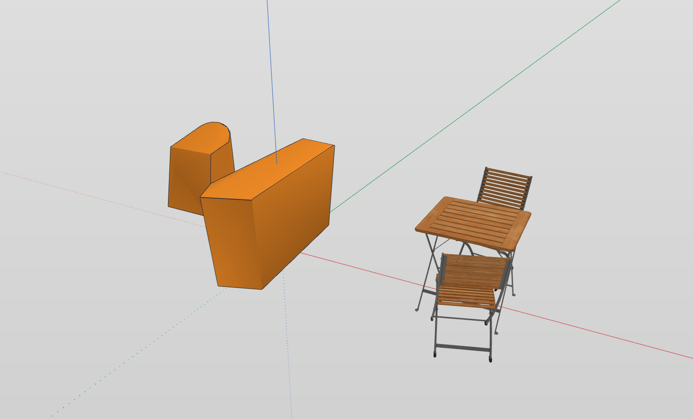
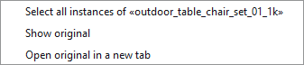
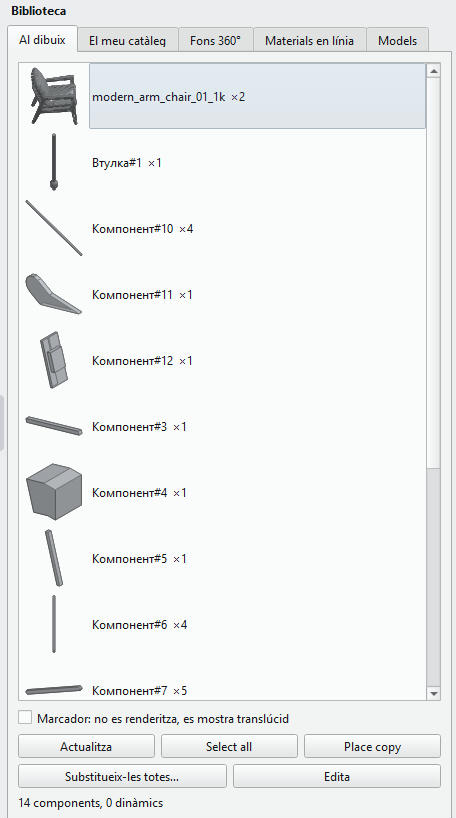
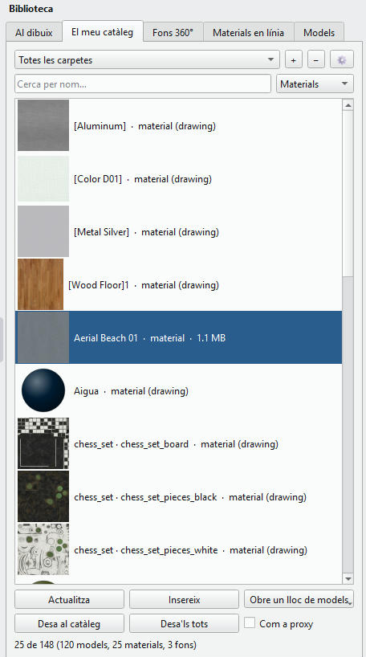
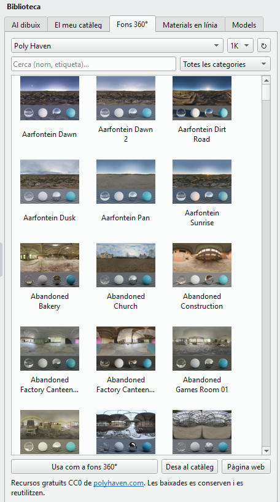
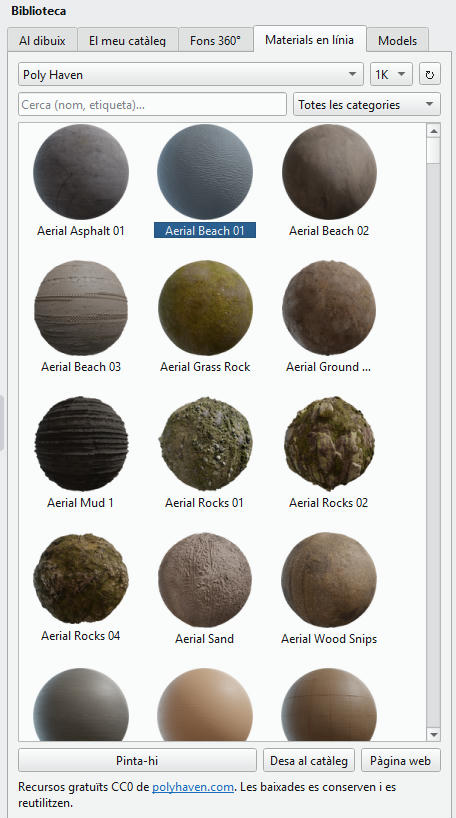
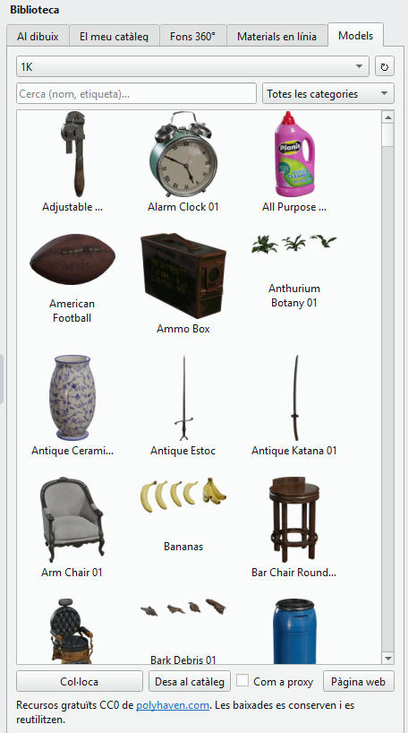

# SketchUp files and Dynamic Components for IngeTrazo

Three [IngeTrazo](https://github.com/ingelibre/ingetrazo) extensions that share one data format
(SketchUp's own Dynamic Components attributes, kept in `group.ext["skp_dc_import"]`) and
install independently:

| Extension | Folder | What it does |
|---|---|---|
| **SketchUp files** | `skp_dc_import/` | Import a `.skp` keeping its component tree and its Dynamic Components data; export the document as a `.skp`. Carries OpenSKP; the export needs a blank `.skp` (see below). |
| **Dynamic components** | `dc_tools/` | Component Options, Component Attributes and the formula engine. Needs no `.skp` file and no OpenSKP. |
| **Library** | `asset_manager/` | A tray tab (named «Biblioteca» in Catalan): the components in the drawing (preview, count, ⚙ on dynamic ones, select every instance, drag a copy onto the view), your own catalog folders (`.igz` and `.skp`, with previews) and the drawing's materials listed beside the catalog's (type filter; **Save to catalog** keeps them, with a simple picture for plain colours; Render Studio `.rsmat` files are read), and free online assets (Poly Haven, ambientCG: HDRIs, full PBR materials, 3-D models) that **Save to catalog** keeps offline; heavy models as light **proxies** (an envelope in the drawing, the full model in an `.igz` of its own and in the render). |

None imports another. Installed together, you can import a `.skp`, edit its dynamic
components and export it back.

## SketchUp files (`skp_dc_import`)

- **Import SketchUp keeping components…** opens a `.skp` with its component tree intact, every
  part a nested IngeTrazo component, and each part's Dynamic Components attributes, formulas and
  options kept, in SketchUp's own format. The file's **scenes** come in as saved views (camera,
  projection and hidden tags), and its **Enscape lights** as Render Studio lights (below).
- **Enscape lights.** A component with Enscape's `Enscape.Light` data (point, spot, linear,
  rectangular and disk lights) becomes a Render Studio light on that component, in its axes:
  lumens as they are, sizes in metres, beam angle in degrees, shining along the component's +Z.
  A linear light is a tube that shines all round, so it comes in as four thin area lights (+Z,
  -Z, +X, -X) with a quarter of the lumens each. Enscape has no colour for a light: they are
  white. The component is only the light's symbol: it stays in the drawing and Render Studio
  (0.17.0 or later) leaves it out of the render.
- **Enscape library objects as stand-ins.** A plant, tree or chair from Enscape's online library
  (Chaos Cosmos) is a component with an `Enscape.Asset` dictionary (`Id`, `Source = REMOTE`) and
  only a light envelope of the real object inside the file. It comes in as a **stand-in**: the
  envelope stays in the drawing, translucent, and the render leaves it out
  (`ext["render_studio"]["hide_in_render"]`); the library Id is kept in `ext["enscape_asset"]`.
  Swap it for a component of your own (Replace Component, or **Replace all…** in the Components
  manager) or draw into it. The same property can be set on any component (below).
- **Export SketchUp (.skp) with dynamic components…** writes the document as a `.skp`
  (SketchUp 2017 format, which every later SketchUp opens) with its groups, components,
  materials and textures, and each part's Dynamic Components data: the components work as
  dynamic components in SketchUp, with their options.
- **SketchUp .skp settings…**: credits and the blank `.skp` the export needs.
- **?** (in the settings window and on the toolbar) opens a help window: import, export, the
  blank file, and what to do when something goes wrong.

## Dynamic components (`dc_tools`)

- **Component Options**: the options a component shows its users (text fields, lists,
  read-only values, in their units). Its **?** button opens the help at the Options section. **Apply** redraws it: copies, hidden parts, sizes,
  positions, rotations and materials, as SketchUp would. Changing LenX/LenY/LenZ resizes it the
  way SketchUp's dialog does.
- **Component Attributes**: **Make dynamic**, then per part: attributes with a value or a
  `=formula`, the predefined ones (X, Y, Z, LenX…, RotX…, Hidden, Material, Copies…) or your
  own, and how each one shows to users (label, access, units, list choices). The **?** button
  opens a help window: how the panel works, what each predefined attribute does, how to write
  formulas and every function with its syntax and an example.
- Both panels also work on a component **inside an open group or component**: select it there
  and edit it in place. A dynamic component inside an open dynamic component sees its parent
  (`Parent!LenX`, its ancestors' and siblings' names), as in SketchUp.
- **Scaling** a dynamic component with IngeTrazo's Scale tool: only the handles its `ScaleTool`
  attribute allows are shown (bits 1 X, 2 Y, 4 Z, 8 XY, 16 XZ, 32 YZ, 64 uniform hide a
  handle), and once scaled — by a handle, a typed value or anything else — it is redrawn at
  its new size (copies, parts that keep their size, formulas) instead of stretched, in the
  same undo step as the scale; the result is the same as typing its LenX/LenY/LenZ.

## Library (`asset_manager`)

- **In drawing**: every component of the document once, with a preview and how many there are
  (the parts inside a dynamic component are not listed). **Select all** selects every instance
  that can be selected where you are editing and says how many are inside other groups; the
  same from the view's right-click menu, **Select all instances of «…»**. **Place copy**, or
  dragging an entry onto the view, places another instance of it.
- **My catalog**: folders of your own **models** (`.igz`, `.skp`, `.gltf`, `.glb`), **materials** and 360° **backgrounds**
  (`.hdr`, `.exr`), all in one list with a **type filter** (all types, models, materials, backgrounds) and a search by
  name; add folders with **+**. A `.skp`
  shows the preview it carries; any model can have a `.png` with the same name next to it.
  Double-click, **Insert** or drag onto the view; a `.skp` comes in keeping its components and
  dynamic data when the `skp_dc_import` extension is installed. When you add a folder you choose
  whether it is **watched in real time** (a model saved or downloaded into it shows at once,
  marked ●) or read again with **Update**. Downloads as they come are understood too: a `.skp`
  or `.igz` **inside a `.zip`** is listed and taken out only when inserted, and a **material
  set** downloaded from any site — a folder or zip with a colour image and its maps (normal,
  roughness, AO, displacement…, recognised by the words in their names) — shows as a
  material: Insert loads the paint bucket with it, its maps copied with a `.pbr.json` manifest
  for Render Studio (the user's folder is left as it is).
- **Materials of the drawing** are listed beside the catalog's, marked **(drawing)**, and have a folder of their own in the
  folder list (*Materials of this drawing*). **Save to catalog** keeps the chosen one in the extension's own folder
  (`Materials/`): its picture and maps, or a simple generated picture for a plain colour, with its translucency and finish;
  **Save all** keeps every one that is not in the catalog yet. A catalog material is a folder with a `.pbr.json` manifest,
  the one Render Studio reads; Render Studio's own `.rsmat` files are read too (its newer `.igmat` files are not yet).
  **Insert** on a material loads the paint bucket with it, on a background makes it the 360° background, on a model
  makes it follow the cursor. The **Open a model site** button and the folders' *watched* option are as before.
- A `.skp` **dragged from the file explorer** onto the view also goes through the `.skp`
  extension's importer (it keeps its components and dynamic data) and follows the cursor to be
  placed, instead of the window's own importer, which flattens it.
- **Open a model site** opens, in your browser, the sites you list in **⚙ Settings**
  (Extensions ▸ Library settings…). Download into a watched folder — your Downloads
  folder, for instance — and the model is in the catalog, ready to drag onto the view.
- **Online** — free CC0 assets from **Poly Haven** (polyhaven.com: HDRIs, materials, 3-D
  models) and **ambientCG** (ambientcg.com: HDRIs, materials, decals and atlases). The online assets have a tab each:
  **360° backgrounds**, **Materials** and **Models**. **HDRIs** become Render Studio's 360°
  background; **materials** come with all their maps (colour, normal, roughness, AO,
  displacement, metal…) and load the paint bucket with the colour image at the material's real
  size (ambientCG's **Decals** and **Atlases** are in this tab too, as categories of their own; they come with an opacity map), with a `<colour image>.pbr.json` manifest next to it naming the other maps for a
  renderer; **3-D models** (glTF) follow the cursor to be placed. Each source is reached only
  on its own servers, over https (redirects checked one by one); downloads are checked (MD5
  where the source gives it), kept in the extension's folder and reused. From an ambientCG zip
  only the map images (or, for an HDRI, the full-range `.exr`) are taken out. A glTF model's
  paints are registered under names that refer to the model («ArmChair_01», or «Model · Fabric»
  when the model has several), and a model comes in as a component, so Replace Component keeps
  its place. **Save to catalog**, on each online tab, downloads the asset (if it is not here yet) and keeps a copy in the
  catalog (`Materials/`, `Models/` or `Backgrounds/` of the extension's folder), so it is there offline and in every drawing.
- **Stand-in** (a check box on In drawing, and in the right-click menu of any selection): the
  component shows translucent in the drawing and the render leaves it out; clear it when the real
  thing is there. **Replace all…** swaps every placement of the chosen component for another one
  of the model (stand-ins are cleared first), **Edit** opens it for editing, **Select all** picks
  every placement.
- **As proxy** (a check box on My catalog and on Online's 3-D models): the model goes in as a
  light **envelope** in its place (its convex hull through some 64 of its outermost points, the
  gentle folds smooth; a rectangle for a flat model), and the full model is kept in an `.igz` of
  its own — in
  `<drawing>_proxies` next to a saved drawing (its path kept relative, so the project folder
  moves as a whole), in the extension's folder while the drawing has never been saved. The same
  model inserted again is a copy of the proxy already there. Good for heavy downloads (trees,
  furniture). A model holding **dynamic components** asks first: as a proxy their options and
  formulas cannot be changed until the original is shown again (while dragging it goes in as a
  proxy and the status line says so). The data follows the
  [Proxies extension](https://github.com/PESI3D/ingetrazo-proxies) (`ext["proxy_tool"]`), so its
  Show Originals / Show Proxies work on these proxies, and a renderer can swap the original in.
- **Right-click menu** on objects at the top level of the drawing — one undo step each:
  **Make proxy** (the object and every copy of its component become one proxy; name, place,
  layer, paint and lights stay; objects holding dynamic components ask first, and their dynamic
  data waits with the original), **Show original** (the full model back from its file, its
  materials registered, still marked as a proxy), **Show proxy** (back to the envelope; an
  original edited meanwhile is saved to its file first), **Open original in a new tab** (its
  `.igz` as a project of its own: edit it there and save; when the drawing comes back to the
  front, its proxies take the change — a new envelope, one undo step — and Show original and the
  render bring the edited model).

The five tabs of the Library, in order (the panel is named «Biblioteca» in Catalan):

<table>
<tr>
<td valign="top"> <b>In drawing</b>: the document's components, with a preview and how many there are.</td>
<td valign="top"> <b>My catalog</b>: models, materials and backgrounds, with a type filter; the drawing's materials are marked <i>(drawing)</i> and <b>Save to catalog</b> keeps them.</td>
<td valign="top"> <b>360° backgrounds</b> (online): free HDRIs, <b>Use as 360° background</b> or <b>Save to catalog</b>.</td>
</tr>
<tr>
<td valign="top"> <b>Materials</b> (online): full PBR sets; <b>Paint with it</b> loads the paint bucket, <b>Save to catalog</b> keeps a copy.</td>
<td valign="top"> <b>Models</b> (online): glTF models that follow the cursor to be placed, also <b>as a proxy</b>.</td>
<td></td>
</tr>
</table>

Every change is one undo step. A long import (the .skp menu, Insert in the catalog, a model dropped from a file) shows a progress window: reading the file, building the parts, preparing the drawing. Versions: skp_dc_import 0.8.0, dc_tools 0.3.5, asset_manager 0.5.1, for IngeTrazo 0.6 (Extension API 2).

## Render Studio

These three extensions have a fourth sibling by the same author, **[Render Studio](https://github.com/moominot/ingetrazo-render-studio)**:
photographic renders through Blender (looks, a sun, a 360° background, a material editor, lights, a live preview).
It is a separate extension and none of the three needs it, but they meet in the drawing's data:

- **SketchUp files** brings the file's lights in as Render Studio lights, and marks the light's symbol so the render
  leaves it out (Render Studio 0.17.0 or later).
- **Library**: its online **HDRIs** are Render Studio's 360° backgrounds; its **materials** come with a
  `.pbr.json` manifest that Render Studio reads to use the normal, roughness, AO, displacement and metal maps; its
  **proxies** are rendered by Render Studio as their full model; and a **stand-in** (translucent in the drawing) is
  left out of the render.
- **Dynamic components**: a component redrawn from its options is just geometry to Render Studio.

So a `.skp` can be imported with its components and lights, its dynamic components edited, its trees and
furniture swapped for downloaded models, and the result rendered, each step by the extension that does it.

## Releases

The packaged extensions are in `releases/` (`dc_tools-0.3.0.zip`, `dc_tools-0.3.1.zip`, `dc_tools-0.3.2.zip`, `dc_tools-0.3.3.zip`, `dc_tools-0.3.4.zip`, `dc_tools-0.3.5.zip`, `dc_tools-0.3.6.zip`, `skp_dc_import-0.6.0.zip`, `skp_dc_import-0.6.1.zip`, `skp_dc_import-0.6.2.zip`, `skp_dc_import-0.6.3.zip`, `skp_dc_import-0.6.4.zip`, `skp_dc_import-0.7.0.zip`, `skp_dc_import-0.7.1.zip`, `asset_manager-0.2.0.zip`, `asset_manager-0.3.0.zip`, `asset_manager-0.3.1.zip`, `asset_manager-0.3.2.zip`), pinned by the catalog by
commit and SHA-256. They do **not** contain `blank_v17.skp` (see «SketchUp files» above). Unpack one in IngeTrazo's plugins
folder, or install it from **Extensions ▸ Manage extensions…**.

## Install

Download `skp_dc_import-<version>.zip`, `dc_tools-<version>.zip` and/or `asset_manager-<version>.zip` from the
[releases](https://github.com/moominot/ingetrazo-skp-dc-import/releases) and unpack each in
IngeTrazo's plugins folder (**Extensions ▸ Open plugins folder**; `%APPDATA%\IngeTrazo\plugins\`
on Windows), so that `…/plugins/skp_dc_import/__init__.py`, `…/plugins/dc_tools/__init__.py` and/or
`…/plugins/asset_manager/__init__.py` exist. Restart IngeTrazo.

Each extension has its own toolbar and its commands in the **Extensions** menu; Options and
Attributes are also in the right-click menu of a selected component, and open as side-tray
panels (also from **Window ▸ Panels**).

## How close to SketchUp

The behaviour was taken from SketchUp 2026 itself: real components and synthetic probes,
redrawn by SketchUp's own Dynamic Components engine and compared part by part (every
placement's transform) with this extension's redraw. Some of what that showed:

- X/Y/Z, LenX/LenY/LenZ and RotX… are **live**: without a formula, a part keeps what its
  placement says (its nominal size × scale for a part with sub-parts).
- A part with sub-parts is redrawn at scale 1 and **stretches its contents** by new/old size;
  the sub-parts' own formulas then set what they control. Copies are not stretched.
- `IF` takes only a **positive** number as true; `IF(-1, a, b)` gives `b`.
- A part's `_lengthunits` is **its own**, not inherited: a part without it reads formulas in
  inches.
- Names resolve to the part itself, its ancestors, siblings and children only; anything
  further fails, and the attribute keeps its value (SketchUp does the same).
- A definition's `_inst__…` keys are a template for new copies, not formulas.

On four real components (about 1,900 formulas, up to three levels of nesting), the redraw
matched SketchUp's on every visible part, and on 23 of 24 option and size changes. The known
difference: a stair landing's base, which SketchUp leaves unstretched when the stair gets wider.

`tests_su/` holds the comparison scripts. They need SketchUp dumps of your own models (not
included), except `test_author_offline.py`, whose cabinet is built the same way in both
programs, and the Library's own tests, run with IngeTrazo's source:
`test_asset_manager_offline.py`, `test_proxy_offline.py` (inserting as a proxy) and
`test_proxy_ops_offline.py` (Make proxy, Show original, Show proxy, Open original in a new tab, undo,
copies, dynamic components). The last two take, as a third argument, the Proxies extension's
`proxy_tool.py` to check that its commands work on these proxies too.

## Export to SketchUp

`skp_dc_import/skp_export.py` is IngeTrazo's own `.skp` writer (`formats/skp_out.py`,
GPL-3.0), which IngeTrazo no longer ships enabled, adapted for dynamic components: every
definition carries its `dynamic_attributes` and every placement its own; hidden parts are
written hidden instead of left out; a part's nominal size goes on its definition and copies
are named «name copy 001», which is how SketchUp's Dynamic Components read them.

Checked by opening the exports in SketchUp 2026: four real components came back with every
attribute value and hidden flag identical, and, redrawn by SketchUp's own engine with options
changed, identical to the originals part by part; a cabinet made in IngeTrazo works in
SketchUp's Component Options (shelves 3 → 5 → 2 → 4).

**About the template.** OpenSKP's writer builds every `.skp` from a blank document,
`blank_v17.skp`, whose bytes came from Trimble's SketchUp SDK (OpenSKP explains it in
`create.py`: SketchUp's empty-document boilerplate, no one's creative work). IngeTrazo
stopped distributing it to ship only free pieces, so **this extension does not include it
either** (since 0.4.0). Importing works without it; to export, open **Extensions ▸ SketchUp
.skp settings…** and either press **Download from OpenSKP** (fixed commit, checked against its
SHA-256) or **Choose file…** with a copy you already have. Only that exact file works: the
writer's offsets are specific to its bytes, so a blank `.skp` saved from SketchUp (including
SketchUp for Web) is rejected. The file is kept in the extension's folder in the user's data
directory.

## Limits

- Not supported: OnClick and animations, `FACEAREA`-style geometry functions, and the
  functions the formula interpreter lacks (see `skp_dc_import/dc/formula.py`).

## Why it carries its own OpenSKP

The OpenSKP bundled with IngeTrazo reads only each instance's attribute dictionaries; SketchUp
keeps a dynamic component's attributes on its definition. `skp_dc_import/_vendor/openskp` is
OpenSKP (MIT, © Ahsan Mehmood) with definition dictionaries added (upstream PR
[iamahsanmehmood/openskp#530](https://github.com/iamahsanmehmood/openskp/pull/530); commit in
`_vendor/OPENSKP_COMMIT`). When IngeTrazo bundles an OpenSKP that has them, the extension uses
that one instead.

## Credits and licence

GPL-3.0-or-later.

- The formula interpreter (`dc/formula.py`, `dc/messages.py`) comes from d1rty-pixel's
  [Dynamic Components for IngeTrazo](https://github.com/d1rty-pixel/ingetrazo-dynamic-components)
  (GPL-3.0), extended here.
- The `.skp` writer is IngeTrazo's `formats/skp_out.py` (GPL-3.0, © Marco Sumari Tellez and
  IngeTrazo contributors), adapted.
- The vendored OpenSKP keeps its MIT licence (`_vendor/openskp/LICENSE`).
- Faces, materials and textures are read with IngeTrazo's own `.skp` adapter.
- Proxies inserted by `asset_manager` use the data format of PESI3D's
  [Proxies](https://github.com/PESI3D/ingetrazo-proxies) extension (GPL-3.0-or-later); no code is
  taken from it.
